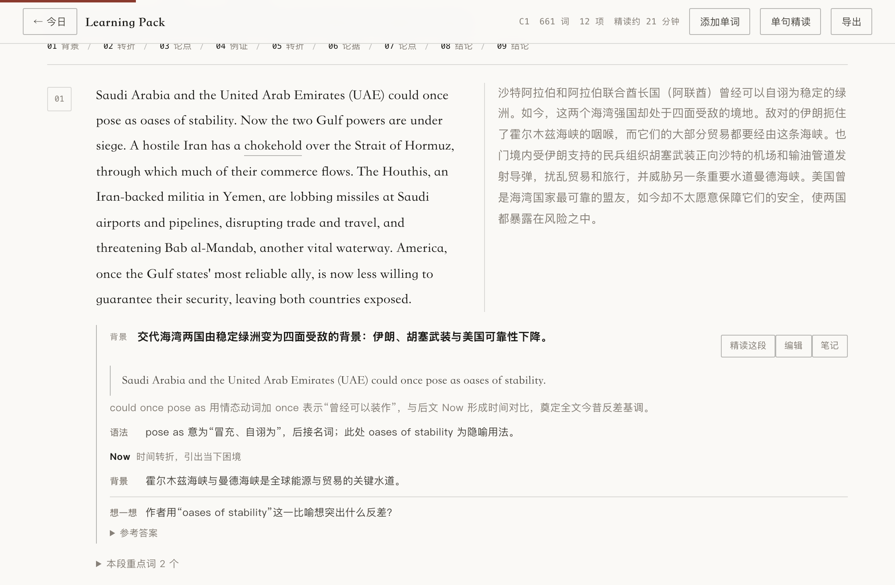

# CloseRead

[](https://github.com/qweijiaq/CloseRead/actions/workflows/ci.yml)

[English](README.md) | [简体中文](README.zh-CN.md)

**CloseRead turns a PDF, EPUB, MOBI, article URL, text file or talk transcript into a paragraph-by-paragraph intensive reading pack: translation, notes, word cards, sentence cards and a local review library.**

It is not a chat tutor, and it is not a flashcard app that happens to contain articles. The loop is **read → understand → collect → briefly review**. The current UI is in Chinese.



*Actual UI: article head, paragraph translation, intensive-reading notes and collapsed word cards.*

## Why not ChatGPT / a vocabulary app?

| | ChatGPT | Vocabulary app | CloseRead |
| --- | --- | --- | --- |
| Real article | Can read it, but you re-prompt every time | Usually no real article | PDF / EPUB / MOBI / URL / text / transcript |
| Structured output | You have to organise it yourself | Word list only | Paragraph translations, notes, grammar, word cards, sentence cards |
| Keep the context | Stays in the chat | Cards lose the article | Cards stay attached to their paragraph |
| Review | No built-in queue | Yes | FSRS queue for words and sentences, plus Anki CSV |
| Where it lives | Cloud account | Usually cloud | Sources, packs, progress and library stay on disk |

## Quick start

Requires **Node.js 22+** and **pnpm 10+** (the repo pins pnpm 11.9 via `packageManager`).

```bash
pnpm install
pnpm dev demo          # build the sample article into a pack
pnpm dev review        # open the local reading UI at http://127.0.0.1:4317
```

`demo` runs the full pipeline on `samples/sample-article.md`: it builds a pack under `packs/`, adds the items to the review library, and generates audio with macOS `say` when available. `review` opens the **Today** reading dashboard; **Review** is a separate flashcard tab.

Add your own material:

```bash
pnpm dev add ./article.pdf
pnpm dev add ./book.epub
pnpm dev add https://example.com/article --build --open
pnpm dev add --clipboard --build
```

CloseRead is currently **source-only**: there is no npm package or one-line installer yet. The local UI and the CLI share the same code.

## What it does

1. **Import** a real source. A bookmarked PDF or an EPUB is split into articles; directory pages, ads, cartoons and digest pages can be filtered out.
2. **Generate** one article. You get a bilingual reading page, paragraph translations, a structure map and intensive-reading notes.
3. **Read** paragraph by paragraph. Select a word or a whole sentence to see its context and add a card without leaving the text.
4. **Go deeper** with etymology, word-family expansion, sentence focus, AI theater, micro-stories and a 60-second warm-up.
5. **Review** only what you chose to keep. Core cards enter FSRS; bonus cards stay in the pack. Export to Anki or Markdown when you want.

## Main features

### Read

- PDF (text layer), EPUB, MOBI/AZW/AZW3, article URLs, pasted text/Markdown and timestamped transcripts.
- English title, Chinese title, standfirst/deck and paragraph-by-paragraph translation.
- A structure map, per-paragraph notes (role, key sentence, grammar, background, reflection question) and a reading progress bar.
- Edit or delete a paragraph; edits re-translate the paragraph and re-sync word and sentence cards.

### Understand

- Sentence focus mode with large text, optional translation, pronunciation, previous/next navigation, merge/split sentence boundaries and “mark this paragraph read”.
- Sentence cards with chunks, pattern, grammar and substitutions for back-translation.
- AI theater: a bounded three-turn interview with the author or a rebuttal challenge, with a recap of expressions used and missed.
- Micro-stories and 60-second sentence/word puzzles built from the cards already in the pack.

### Collect

- Select 1–8 words or a complete sentence; the card stays attached to the paragraph it came from.
- Contextual translation and a short annotation appear before you add anything.
- Word cards include etymology, roots and affixes, a derivation tree, word family, synonyms, antonyms, confusables, collocations and examples.
- Sentence cards keep the full source sentence, translation, chunks and pattern.

### Review

- FSRS scheduling for word and sentence cards.
- Core/bonus split: core cards enter the queue; bonus cards stay in the pack.
- Anki CSV, Markdown for Obsidian, and HTML/EPUB/PDF/PNG export. MOBI export needs Calibre.

### Extras

- Reading passport with a 3:4 share card.
- Full-article audio and sentence-by-sentence shadowing with local recording.
- Audio can use macOS `say`, browser speech, or a configured neural TTS provider (Edge online, GLM-TTS, Gemini TTS, MiniMax, ElevenLabs or an OpenAI-compatible endpoint).

## Inputs and outputs

`PDF` `EPUB` `MOBI` `AZW/AZW3` `URL` `Text` `SRT/VTT` · `HTML reader` `Markdown` `Anki CSV` `EPUB` `PDF` `PNG` `MOBI`

| | |
| --- | --- |
| **Input** | Text-layer PDFs, EPUB/MOBI/AZW/AZW3, article URLs, pasted text/Markdown, talk transcripts. Audio/video needs a sibling transcript. |
| **Output** | Interactive HTML reader, Markdown for Obsidian/print, Anki CSV; the UI can also export EPUB, PDF, PNG and (with Calibre) MOBI. |
| **Platform** | Node 22+ on macOS, Linux or Windows. PDF/PNG export uses local Chrome; MOBI export uses Calibre when installed. |
| **Models** | No LLM key needed for heuristic mode; add a DeepSeek/OpenAI/GLM-compatible key for AI notes, translations, word expansion and selection. |
| **Audio** | Optional. macOS `say` works offline; other systems can use browser speech or configure a neural TTS endpoint. |

## Is this for you?

CloseRead is for people who want to read real English articles slowly and keep the useful parts: exam preparation, foreign-magazine reading and long-term vocabulary building. It is less useful if you want a one-click summary, do not want to configure a model key, or need scanned PDF OCR today.

## Limitations

- No OCR for scanned PDFs.
- DRM-protected EPUB, MOBI and AZW files cannot be decrypted; use a DRM-free copy.
- Paywalls, login walls and bot checks are not bypassed.
- Video/audio transcription is not built in; bring a transcript.
- Heuristic Chinese definitions are dictionary/translation glosses, not context-aware paraphrase. LLM mode gives better sense-level Chinese.
- The review server binds to `127.0.0.1` and has no authentication. Do not expose it.
- Copyright: use this for personal study. Do not redistribute packs that contain full source text.

## Development

```bash
pnpm typecheck
pnpm test
```

Tests use Node's built-in test runner via `tsx`. The CLI runs from source with `tsx`; there is no separate build step.

## License

MIT
