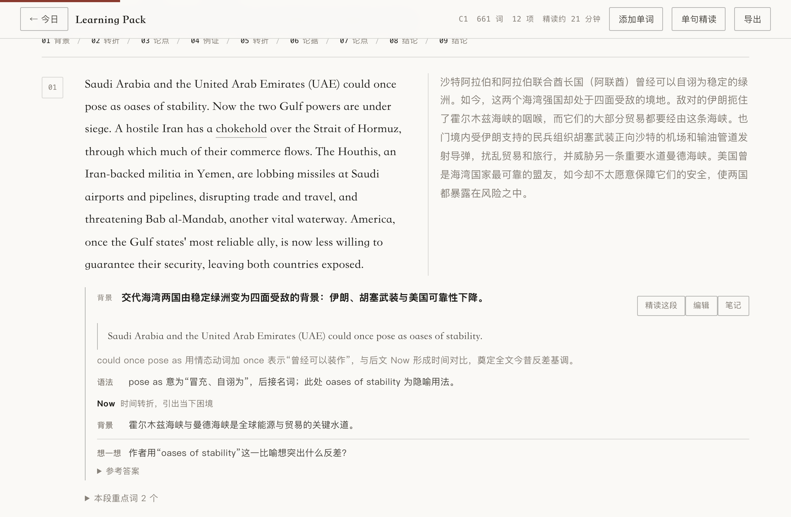

# CloseRead · 细读

[](https://github.com/qweijiaq/CloseRead/actions/workflows/ci.yml)

[English](README.md) | 简体中文

**CloseRead 把一个 PDF、EPUB、MOBI、DOCX、网页链接、文本文件或演讲转录，做成一份可以逐段精读的学习包：译文、笔记、词卡、句子卡，以及留在本地的复习库。**

它不是聊天外教，也不是一个“碰巧放了几篇文章”的背单词 App。主循环是 **读 → 懂 → 收 → 少量复习**。界面支持中英切换，英文为 beta；AI 生成的学习内容仍以中文为主。



*实际界面：文章头、逐段译文、精读笔记和折叠的词卡。*

## 为什么不是 ChatGPT / 背单词 App？

| | ChatGPT | 背单词 App | CloseRead |
| --- | --- | --- | --- |
| 真实文章 | 能读，但每次都要重新提问 | 通常没有完整文章 | PDF / EPUB / MOBI / DOCX / 网页 / 文本 / 转录 |
| 结构化产出 | 需要自己整理 | 只有词表 | 逐段译文、笔记、语法、词卡、句子卡 |
| 保留语境 | 留在对话里 | 卡片离开原文 | 卡片跟着来源段落走 |
| 复习 | 没有内置队列 | 有 | 单词和句子卡的 FSRS 队列，可导出 Anki CSV |
| 数据在哪 | 云端账号 | 通常也在云端 | 原文、学习包、进度和词库都在本机 |

## 快速开始

需要 **Node.js 22+** 和 **pnpm 10+**（仓库通过 `packageManager` 固定 pnpm 11.9）。

```bash
pnpm install
pnpm dev demo          # 用示例文章生成一个学习包
pnpm dev review        # 打开本地阅读界面：http://127.0.0.1:4317
```

`demo` 会对 `samples/sample-article.md` 跑完整流程：生成学习包、把卡片加入复习库；macOS 有 `say` 时会顺带生成音频。`review` 打开「今日」阅读首页，「复习」是单独的卡片标签页。

导入自己的材料：

```bash
pnpm dev add ./article.pdf
pnpm dev add ./book.epub
pnpm dev add https://example.com/article --build --open
pnpm dev add --clipboard --build
```

任意文章页都可以从 `/bookmarklet` 安装本地书签；点一下就会打开导入表单并填好当前链接。

目前还是源码运行：没有 npm 包，也没有签名的安装包。仓库里有一个轻量 Electron 桌面壳：

```bash
pnpm desktop        # 从源码运行桌面版
pnpm desktop:pack   # 生成未打包的桌面应用，输出到 desktop-dist/
pnpm desktop:build:mac  # 生成未签名的 macOS dmg
pnpm desktop:build:win  # Windows NSIS，请在 Windows 上运行
```

打包说明见 [desktop/README.md](desktop/README.md)。仓库里还有一份只读静态演示 [`demo/index.html`](demo/index.html)，附带 GitHub Pages 工作流。阅读首页和学习包顶栏都有 `EN` 切换。

## 数据在哪里

`pnpm dev` 把词库放在仓库的 `data/`，学习包放在 `packs/`。桌面版使用系统应用数据目录：macOS 是 `~/Library/Application Support/closeread/`，Windows 是 `%APPDATA%\closeread`，Linux 是 `~/.config/closeread`。设置 `LEARN_DATA_DIR` 和 `LEARN_PACKS_DIR` 可以让两者指向同一个文件夹；桌面版从终端启动时（例如 `LEARN_DATA_DIR=... pnpm desktop`）也会使用这两个变量。

词库是单个 `store.json`，加上每份导入材料一个 JSON 文件。CloseRead 会原子写入，并保留：

- `store.json.bak` — 上一份可用的版本；
- `data/backups/store-YYYY-MM-DD.json` — 每天一份快照，保留 7 天；
- `store.json.corrupt-<timestamp>` — 无法解析的文件会被移到隔离位置，并在界面顶部提示，而不是被静默覆盖。

恢复时先停掉服务，把选中的快照复制回 `store.json` 即可。自动每日快照只覆盖词库 store。`pnpm dev backup` 生成的可迁移归档会包含 store、导入材料、学习包目录（含 `reading.json` 和缓存音频）以及本机金句墙；`data/lab/audio/` 属于可再生成的缓存，不放进归档。

需要一份可迁移的词库副本时：

```bash
pnpm dev backup                  # 写入 data/backups/library-<timestamp>.json
pnpm dev restore <file> --force  # 先停掉服务
```

手动恢复会先留一份 `store.json.pre-restore-<timestamp>`，并且只覆盖备份里包含的记录。学习包目录会重新映射到当前的 `LEARN_PACKS_DIR`。成长页也提供 **下载完整备份**，通过本地服务生成同一份归档。

删除学习包或材料时会先进 `data/trash/`；打开 **设置 → 回收站** 可以恢复或彻底删除。回收站会保留学习包记录、词条复习状态和上传文件。

## 手机访问

主服务只绑定 `127.0.0.1`。要在同一 Wi-Fi 下的手机或平板上阅读、复习：

- 打开应用里的 **手机** 面板，点 **开启手机访问**；或者运行 `pnpm dev review --lan`。
- 开启后直接用手机相机扫描面板里的二维码即可打开带令牌的链接；二维码在本机生成，不经过第三方服务。
- 在手机浏览器里选择“添加到主屏幕”，或在电脑浏览器里安装 CloseRead，可以像独立应用一样打开；数据和令牌仍只在本机。
- 在手机上打开一次带令牌的链接。令牌会写入 HttpOnly Cookie，并从地址栏去掉；之后应用内的相对链接和 API 会自动带上它。
- 手机令牌是学习令牌：可以阅读、复习、加词/加句、写输出和使用练习；导入、删除、重新生成学习包、修改模型/语音设置只能在电脑上操作。
- 手机访问使用独立的随机局域网端口，并且每个请求都需要令牌。关闭会停掉这个监听端口；下次开启会轮换令牌（除非用 `LEARN_ACCESS_TOKEN` 固定）。
- 只在可信网络使用：局域网连接是 HTTP，不是 HTTPS；不要在公共 Wi-Fi 开启。手机打不开时，先检查系统防火墙和路由器的 AP 隔离。
- `LEARN_ACCESS_TOKEN` 可以固定令牌（适合自动化）；否则每次开启手机访问都会生成新令牌。

## 更安静的工作台

现在全站使用同一套壳：桌面左侧栏、移动端底部导航，以及统一的视觉语言。今日、复习、词库、成长、实验室和阅读页不再各自为政；每个页面只保留一个主行动，次要操作收在下面。默认阅读页是 `/read/:id`：在这里选中一个词或一句话，可以直接加入词卡或句子卡；旧的 `/pack/:id` 保留为 **工具模式**，用于完整笔记、编辑和 AI 剧场。


### 导入时 AI 清理正文

粘贴文本和网页文章在入库前可以过一遍模型。配置了模型 Key 时，导入表单里的 **AI 清理正文** 默认开启。模型只拿到编号段落，**只能删除导航、Cookie 提示、订阅/Newsletter、相关推荐、广告、页脚等样板段落**，不能改写正文。模型失败或想删掉超过 60% 的段落时，会保留原文并给出警告。

CLI 可以用 `pnpm dev add --no-ai-clean` 保留原始提取文本。PDF/EPUB 目前有意跳过这一步，避免破坏页码和书的结构。


### 可以真正背起来的词库

词库不再只是列表：按 **新词 / 到期 / 易忘 / 已掌握** 分组，按来源、词书或 CEFR 过滤，并可按到期、最近添加、字母、CEFR、词频或易忘次数排序；点开完整词卡（语境、搭配、例句、关系、词源、笔记），然后开始「今日背词」：**默认 10 个新词 + 到期复习**。复习队列是唯一的学习入口，和全站共用同一套 FSRS 调度。

「词书库」可以一键加入四级（4,544）、六级（3,991）、托福（10,367）和雅思（7,298）；加入后会进入同一套 FSRS 词库，和文章里收集的词一起复习。来源与许可写在 [src/wordbooks/ATTRIBUTION.md](src/wordbooks/ATTRIBUTION.md)：四六级/托福词表来自 BSD-3-Clause 的 KyleBing/english-vocabulary，雅思来自 CC BY 4.0 的 Word Atlas，音标来自 MIT 的 ECDICT。内置雅思是 7,298 词的第三方数据集，不是官方完整词表。

词库现在有**每日预算**：默认到期复习最多 10 个、新词最多 10 个，可在设置中心调整；词书加入后先进入**待学池**，每天按新词目标释放。复习页和两个「背词」入口共用同一个队列，一次加入一万个托福词也不会再把待复习数变成一万。

没有真实例句的词会标记为**无例句**，练习会跳过；在词库的提示条里可以按 5 或 10 个一批生成例句。每个词会调用一次模型，所以不做隐藏的全量任务。


### 练习：听、说、写

打开 `/lab`，或点侧栏的 **练习**。3 个任务都从你的**学习词库**取词，不再绑定某一篇文章；先选范围（全部 / 新词 / 到期 / 易忘 / 收藏），题目优先使用带真实例句的词。

- **听写诊所**：听词库例句，逐词写下来对照。
- **影子跟读**：听、跟、录、回放；录音只在本机。
- **生活例句**：把一个目标词放进工作、旅行、爱好或日常，由 AI 写三句。

只有「生活例句」需要模型 Key；听写和影子跟读没有 Key 也能用。AI 结果缓存在 `data/cache/lab/`，任务音频缓存在 `data/lab/audio/`。


1. **导入**真实材料。带书签的 PDF 或 EPUB 会先拆成文章，目录、广告、漫画和新闻摘要可以过滤掉。
2. **生成**其中一篇。得到双语阅读页、逐段译文、文章结构图和精读笔记。
3. **阅读**时按段落推进。选中一个词或一整句，先看语境译文和注释，再决定要不要加卡。
4. **深入**：词源、词族发散、单句精读、AI 小剧场、微故事和 60 秒小游戏。
5. **复习**你真正想留下的内容。核心卡进入 FSRS，Bonus 卡留在学习包里；需要时导出 Anki 或 Markdown。

## 学习包产物

每个学习包都是一个可以自己保存、检查、迁移的文件夹：

`pack.json` · `meta.json` · `pack.md` · `anki.csv` · `index.html` · `reading.json`

`meta.json` 记录输入 hash、模式、模型、prompt 版本、生成时间和警告，不包含 API Key；以后换模型或改 prompt 时可以对比和复现。

## 主要功能

### 阅读

- 支持 PDF（需要文字层）、EPUB、MOBI/AZW/AZW3、DOCX、网页链接、RSS/Atom 订阅、粘贴文本和时间戳转录。
- 英文标题、中文标题、导语/摘要和逐段译文。
- 文章结构图、每段精读笔记（作用、关键句、语法、背景、想一想）和阅读进度条；默认阅读页可直接展开每段笔记，不必切到工具模式。
- 书籍分篇后的上一章/下一章导航；默认阅读页支持选中看释义和本地批注。
- 默认阅读页支持逐句听读：点任意句子或“逐句听”，当前句会高亮并自动滚动到视野内。
- 每篇末尾的“接下来读”会按 CEFR、篇幅、同书和阅读状态推荐下一篇。
- 可以编辑或删除段落；保存后会重新翻译该段，并同步单词卡和句子卡。
- 深色 / 纸色 / 跟随系统主题，以及字号、行高、版心三组阅读设置，会记在本机。

### 理解

- 单句精读：放大原文、按需翻译、发音、前后切换、合并/拆分句子边界、标记本段已读。
- 句子卡保留完整原句、译文、意群、句型和替换表达，适合回译。
- AI 小剧场：三句话采访作者，或反驳 AI；结束后回看用过和漏掉的表达。
- 微故事和 60 秒金句拼图/词根拼装，直接用包里已有的卡片生成。

### 收集

- 选中 1–8 个词或一整句，卡片会留在来源段落，不会全堆到页面底部。
- 添加前就能看到语境译文和简短注释。
- 词卡包含词源、词根词缀、派生图、词族、同反义、易混词、搭配和例句。
- 词库详情可以编辑义项、中英释义、记忆钩子、搭配和笔记；修改会同步到该词所在的学习包。
- 句子卡保留原句、译文、意群和句型。

### 复习

- 单词卡和句子卡都使用 FSRS 排期，目标记忆率可以在 85%–95% 之间调整。
- 首次作答正确率单独统计，重复复习不会把正确率刷高。
- 队列上方显示未来 7 天到期负载；可以用按钮或 `U` / `Cmd/Ctrl+Z` 撤销上一次评分；连续遗忘 4 次以上的卡会标为“易忘”，提示暂停或改写。
- 核心卡进入每日队列；Bonus 卡只在学习包中展示。
- 词库支持多选：勾选任意单词卡或句子卡，直接开始一轮自定义复习，也可以批量暂停、标记掌握、恢复或收藏。
- 已有一份“我认识的词”列表时，可以直接粘贴或上传 CSV/TXT；匹配到的词会标记为已掌握，不新增卡片。
- 支持 Anki CSV、Obsidian/打印用 Markdown，以及 HTML/EPUB/PDF/PNG 导出；MOBI 导出需要 Calibre。

### 写作

- 读完文章后写三句英文，保存到本机输出记录。
- 可以让编辑给一次反馈，也可以基于反馈继续“改写一版”；每一版单独保存、单独获取反馈，方便比较自己改了什么。

### 额外

- 24 个词的词汇诊断，用来建立初始水平和已知词表，避免第一篇文章从零开始猜。
- 阅读成就和 12 周阅读日历（连续天数、复习、输出、夜猫子/早起鸟），全部从已有记录派生，不新增存储。
- AI 语境侦探：从复习卡生成一个小场景和三句用法，其中只有一句最自然；答完给中文解释，并记录连对。需要配置模型 Key。
- **成长** 包含阅读护照和每周复盘（最近 7 天：读完文章、复习正确率、错得最多的词和下周建议），可导出 Markdown 周报；复盘页还显示最近 14 天复习曲线、按来源/CEFR 的留存率，以及每周文章/学习天数目标进度。
- 阅读护照和 3:4 分享卡。
- 整篇音频和逐句跟读，支持本地录音回放。
- 音频可以使用 macOS `say`、浏览器朗读，或配置神经语音（Edge 在线语音、智谱 GLM-TTS、Gemini TTS、MiniMax、ElevenLabs、OpenAI 兼容接口）。

## 输入与输出

`PDF` `EPUB` `MOBI` `AZW/AZW3` `DOCX` `网页` `RSS/Atom` `文本` `SRT/VTT` · `HTML 阅读页` `Markdown` `Anki CSV` `EPUB` `PDF` `PNG` `MOBI`

| | |
| --- | --- |
| **输入** | 带文字层的 PDF、EPUB/MOBI/AZW/AZW3、DOCX、文章 URL、RSS/Atom 订阅、粘贴文本/Markdown、演讲转录。订阅会导入最新一篇。音视频需要同时提供转录文本。 |
| **输出** | 交互式 HTML 阅读页、Obsidian/打印用 Markdown、Anki CSV；界面还可以导出 EPUB、PDF、PNG，以及通过 Calibre 导出 MOBI。 |
| **平台** | Node 22+，支持 macOS、Linux、Windows。PDF/PNG 导出使用本机 Chrome；MOBI 导出需要安装 Calibre。 |
| **模型** | 不填模型 Key 也可以使用规则模式；填入 DeepSeek/OpenAI/GLM 等兼容 Key 后，可以使用 AI 笔记、翻译、词卡发散和选词。 |
| **音频** | 可选。macOS `say` 可离线使用；其他系统可以用浏览器朗读或配置神经语音接口。 |

## 适合谁

适合想慢慢读真实英文、并留下有用表达的人：考研、雅思托福、外刊精读、长期积累词汇。只想一键总结、不想配置模型 Key，或者需要扫描版 PDF OCR 的人，可能不适合。

## 限制

- 暂不支持扫描版 PDF 的 OCR。
- DRM 加密的 EPUB、MOBI、AZW 无法解密，请使用无 DRM 的文件。
- 不绕过付费墙、登录墙或机器人验证。
- 不内置音视频转录，需要自带转录文本。
- 规则模式下的中文释义来自词典/翻译接口，不是结合语境的改写；LLM 模式的释义更贴近上下文。
- 复习服务只监听 `127.0.0.1`，没有登录鉴权，不要暴露到公网。
- 版权：仅供个人学习，不要重新分发包含完整原文的学习包。

## 开发

```bash
pnpm typecheck
pnpm lint            # tsc + noUnusedLocals / noUnusedParameters
pnpm format:check    # 空白、换行和 tab 检查
pnpm test
pnpm test:e2e        # Chrome 浏览器流程（可用 CHROME_PATH 指定）
```

测试使用 Node 内置测试运行器和 `tsx`。`pnpm test` 跑单元/集成测试和几个小型 Chrome 冒烟；`pnpm test:e2e` 跑一条种子数据浏览器流程（导入 → 阅读 → 设置 → 复习/撤销 → 诊断 → 导出）。两者都使用本机 Chrome，也可以用 `CHROME_PATH` 指定。CLI 直接从源码运行，没有单独的构建步骤。Agent/CLI 调用说明见 [AGENTS.md](AGENTS.md)。

## 许可

MIT
