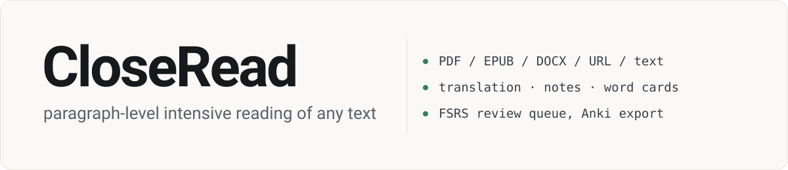
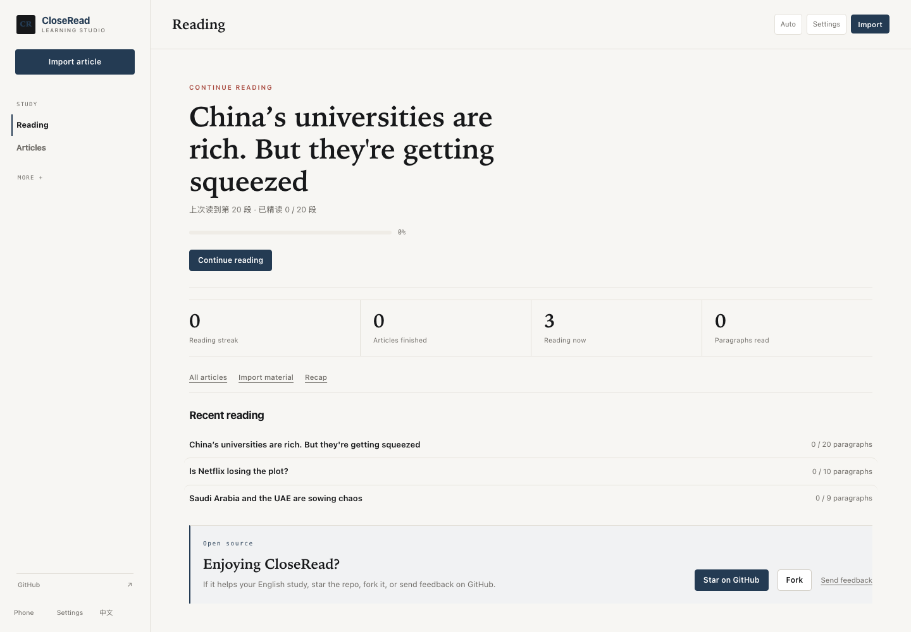
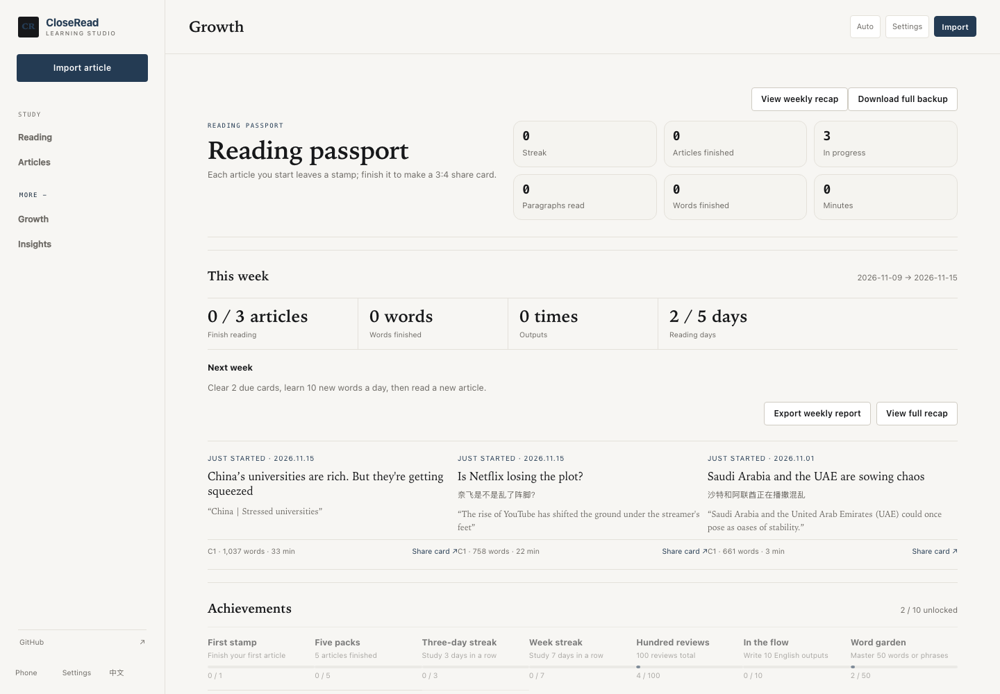
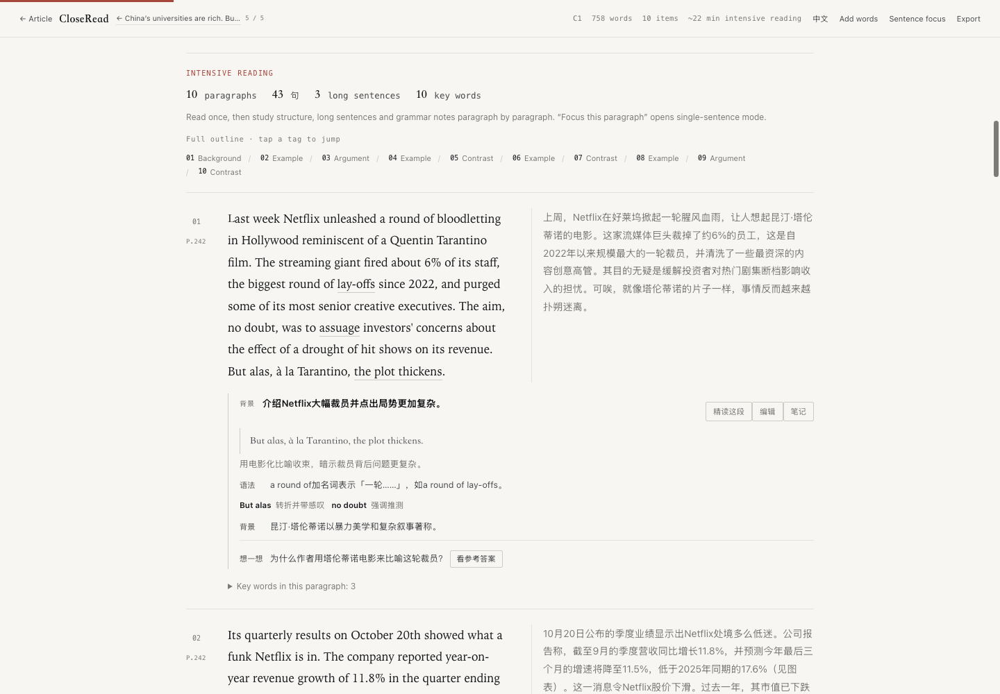
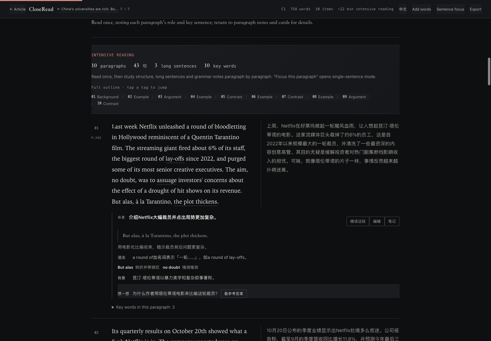

<p align="center">
  
</p>

<h1 align="center">CloseRead · 细读</h1>

<p align="center">
  <a href="https://github.com/qweijiaq/CloseRead/actions/workflows/ci.yml"></a>
  <a href="LICENSE"></a>
  <a href="package.json"></a>
</p>

<p align="center">
  <a href="README.md">English</a> · <strong>简体中文</strong>
</p>

**CloseRead 把一篇英文文章、PDF、EPUB、MOBI、DOCX、网页链接或演讲转录，做成一份可以逐段精读的学习包：译文、笔记、词卡、句子卡、练习，以及留在本地的阅读记录。**

它是一个阅读工作台，不是聊天外教，也不是“碰巧放了几篇文章”的背单词 App。主循环是 **读 → 懂 → 留下**。没有账号、没有云端数据、没有埋点。模型 Key 只有导入自己的材料时才需要：不配置也能读公共库里别人公开的文章，答案都已经预生成好了。界面支持中文和英文 beta；生成的学习笔记默认仍是中文。



*精读首页：继续读当前文章，查看阅读统计和最近的学习包。*

## 为什么还需要一个阅读工具？

| | 常见的问题 | CloseRead 的做法 |
| --- | --- | --- |
| 真实文本 | 聊天回答散在对话里；背单词 App 里通常没有这篇文章 | 一篇文章一个学习包，保留完整原文、段落顺序和页码/时间戳 |
| 语境 | 词卡离开原句，只剩一个孤立的词 | 每张卡都跟着来源段落走，原句和上下文一起保留 |
| 产出 | 译文、笔记、练习还要自己整理 | 译文、结构图、段落笔记、词卡、完形、阅读理解和讨论都在同一页 |
| 归属 | 进度和学习记录留在别人的账号里 | 原文、学习包、阅读进度和备份都在你自己的磁盘或浏览器里 |

## 学习包里有什么

### 读

- 支持带文字层的 PDF、EPUB、MOBI/AZW/AZW3、DOCX、HTML、TXT/Markdown、文章链接、RSS/Atom 订阅和带时间戳的转录。
- 粘贴正文后会先估算「预计几项、几段、什么难度、读多久」，再决定要不要生成。
- 按 `Cmd/Ctrl + K` 打开命令面板，直接跳到精读 / 文章 / 公共库 / 意见墙 / 设置，或导出。
- 纯文本和 Markdown 会按 `# 标题`、`第 3 章`、`Chapter IV`、`【小标题】` 切开，参考文献、索引和尾注会被丢掉，不会当成正文读。
- 双语阅读页：英文标题、中文标题、导语和逐段译文。
- 读前导读：文章地图、作者立场、语言线索和一个具体的阅读策略。
- 每段精读笔记：作用、关键句、语法、连接词、背景，以及一个把你送回原文的问题。
- 单句精读：放大原文、按需翻译、发音、前后切换、合并/拆分句子边界、标记本段已读。
- 选中 1–8 个词或一整句，就能看释义并加卡，不必离开正文。
- 四档字号、三档行高、三档版心，以及纸色/夜间/跟随系统主题，按浏览器记住。
- PDF 使用 pdf.js 并做双栏还原、重复页眉页脚清理，跳过前置页、目录、索引和参考文献；书签或标题会把长 PDF 拆成章节。

### 懂

- 词卡包含语境、中文释义、词源、词根词缀、派生图、词族、同反义、易混词、搭配和例句。
- 句子卡保留完整原句、译文、意群、句型、语法、替换表达和三种语域改写，适合回译。
- 完形填空、阅读理解（事实、推断、主旨、选词）和讨论题，参考答案可以展开。
- 24 个词的词汇诊断，用来校准文章难度和生词标注；结果只留在你的浏览器里。

### 留下

- 段落批注、收藏和“已掌握”状态，跟着学习包一起保留。
- 读完后写三句英文，可以让编辑给反馈；每次改写单独保存，前后版本可以对照。
- 每篇文章记录已读段落和完成度；阅读护照、成就和 12 周阅读日历都从已有记录派生，不额外存数据。
- 每周复盘：读完文章、阅读词数、写作输出和学习天数，可导出 Markdown 周报。
- 整篇音频和逐句跟读，支持本地录音回放。音色可以用 macOS `say`、浏览器朗读，或配置神经语音。



*阅读护照、每周复盘和成就都从已有阅读记录派生。*

### 公共库与意见墙

- **公共库**是服务器上的共享书库：任何人（包括没有模型 Key 的访客）都能直接读，答案和翻译在发布前已经预生成好。
- 自己生成的学习包可以点「公开」放进公共库；作者本人或站点作者可以「取消公开」。
- 打开公共库里的文章时，服务器会把这份包复制进你的空间，之后的进度、批注和词卡都归你自己。
- 公共库支持按标题搜索、按难度筛选、按发布时间或篇数排序。
- **意见墙**：提交想法或 bug，支持附加截图；别人可以「加一」，状态分 待处理 / 已采纳 / 已修复 / 已驳回，作者可以回复。

### 导出

- 交互式 HTML、EPUB、PDF（舒适/紧凑）和 PNG（单张长图或分页 ZIP）。
- Anki CSV、独立学习包 Markdown，以及包含批注、句子卡和词汇的精读笔记 Markdown。
- 安装 Calibre 后可导出 MOBI；PDF/PNG 渲染使用本机 Chrome。
- 设备迁移文件：学习项、导入材料、学习包、阅读进度、批注和设置，换手机或换电脑时导入即可。



*文章、译文、段落笔记和结构图在同一条阅读流里。*

## 从源码安装

CloseRead 目前 **只提供源码**：没有 npm 包，也没有签名的安装包。需要：

- **Node.js 22+**
- **pnpm**（仓库通过 `packageManager` 固定 `pnpm@11.9.0`）
- 支持 macOS、Linux 和 Windows
- 可选：Chrome 用于 PDF/PNG 导出，Calibre 用于 MOBI 导出，macOS `say` 用于离线音频

```bash
git clone https://github.com/qweijiaq/CloseRead.git
cd CloseRead
pnpm install
pnpm dev demo
pnpm dev review
```

`demo` 会把仓库里的示例文章跑成学习包，写到 `packs/`；`review` 在 <http://127.0.0.1:4317> 启动本地服务。

导入自己的材料，可以用界面里的导入面板，也可以用 CLI：

```bash
pnpm dev add ./article.pdf --build --open
pnpm dev add ./book.epub --build
pnpm dev add https://example.com/article --build --open
pnpm dev add --clipboard --build
```

粘贴文本和网页文章可以选择 **清理正文**：只删除导航、Cookie 提示、订阅推广、相关推荐和页脚等整段样板内容，不改写正文。想保留原始提取结果时用 `--no-ai-clean`。PDF 和 EPUB 默认跳过这一步，避免破坏页码和书的结构。

任意文章页都可以从 `/bookmarklet` 安装本地书签；点一下会用当前网页地址打开导入表单。

### 桌面版

仓库里有一个轻量 Electron 壳，但不是签名或公证过的发行版：

```bash
pnpm desktop              # 从源码运行
pnpm desktop:pack         # 生成未打包应用，输出到 desktop-dist/
pnpm desktop:build:mac    # 未签名的 macOS dmg
pnpm desktop:build:win    # Windows NSIS，请在 Windows 上运行
```

桌面版把数据放在 Electron 的 `userData` 目录。打开 **设置 → 数据与学习包** 可以看到确切路径。打包说明见 [desktop/README.md](desktop/README.md)。

## 模型与语音

不配置模型 Key 时，你可以读公共库和示例文章；但**导入自己的材料需要 Key**，否则只会按规则挑出候选词，不会生成中文译文。

配置 Key 后，可以使用 DeepSeek、OpenAI 兼容接口、Anthropic、Gemini、Qwen/百炼、GLM/智谱、xAI、Moonshot、OpenCode Zen、OpenCode Go 或 OpenDesign。在导入面板的 **模型设置** 里填写，或使用 `DEEPSEEK_API_KEY`、`OPENAI_API_KEY`、`ANTHROPIC_API_KEY`、`GEMINI_API_KEY`、`DASHSCOPE_API_KEY`、`GLM_API_KEY` 等环境变量。本地模式下 Key 保存在 `data/llm.json`；公开部署下只存在访客自己的浏览器里。

语音是另一项可选配置，支持 macOS 系统语音、Microsoft Edge 在线语音、阿里云百炼 `qwen3-tts-flash`、GLM-TTS、Gemini TTS、MiniMax、ElevenLabs 和 OpenAI 兼容的 `/audio/speech` 接口。

## 数据在哪里

`pnpm dev` 会把所有内容放在仓库下的两个文件夹：

```text
data/
  store.json              学习项、学习包、卡片状态、输出和偏好
  store.json.bak          上一份可用的快照
  store.json.corrupt-*    无法解析的文件会移到隔离位置，不会被覆盖
  backups/                每日快照，保留 7 份
  resources/              每份导入材料一个 JSON
  trash/                  删除的学习包和材料
  llm.json, tts.json      服务商设置和 API Key
  cache/                  词典、翻译和模型缓存
packs/<id>/
  pack.json, meta.json, pack.md, notes.md, anki.csv, index.html
  reading.json            段落进度和批注
```

设置 `LEARN_DATA_DIR` 和 `LEARN_PACKS_DIR` 可以把这两个文件夹移到别处，例如从终端启动桌面版时。

CloseRead 会原子写入，并保留上一份可用快照；但本地模式是单用户应用，**同一个数据目录只运行一个服务**。两个服务同时写 `store.json` 会互相覆盖。

### 公开部署时数据在哪里

设置 `LEARN_PUBLIC_HOST` 后进入公开模式，存储位置完全不同：

```text
访客的浏览器（IndexedDB）
  store.json、packs/<id>/*、阅读进度、批注、设置

服务器
  data/                 演示内容 + 访问统计（几十 KB）
  data/run/users/<id>/  访客临时工作区，重启后保留，7 天没动就清掉
```

服务器**不是数据存放地**：文章和学习包的正式副本在访客浏览器里。`data/run/` 只是“上一次打开时的样子”，留着是为了刷新和重新部署时不用再把几 MB 的库重新上传一遍；7 天没访问的工作区会在启动时删掉。换设备用 **设置 → 设备迁移** 导出再导入。详见 [DEPLOY.md](DEPLOY.md)。

### 备份与恢复

每日自动快照只覆盖 `store.json`。要一份包含原文、学习包、`reading.json`、缓存音频和金句的可迁移副本，用 **设置 → 设备迁移**，或：

```bash
pnpm dev backup                  # 写入 data/backups/library-<timestamp>.json
pnpm dev restore <file> --force  # 先停掉服务
```

恢复会先留一份 `store.json.pre-restore-<timestamp>`，并把学习包目录重新映射到当前的 `LEARN_PACKS_DIR`。删除学习包或材料时会先进 `data/trash/`；打开 **设置 → 回收站** 可以恢复或彻底删除。

## 隐私

CloseRead 没有账号、埋点、统计、广告或云同步。只有你主动操作时才会发起网络请求：

- **网页/RSS 导入**：直接抓取目标页面。
- **模型笔记和翻译**：把你选中的文章文本发给你配置的服务商。
- **不配置模型时**：单词和短文本查询会访问 `api.dictionaryapi.dev`、`api.datamuse.com`、`dict.youdao.com` 和 `api.mymemory.translated.net`。
- **在线语音**：把要朗读的文本发给你选择的语音服务；本机系统语音不会。
- **手机访问**：在局域网内用普通 HTTP 提供应用，并用 HttpOnly Cookie 里的随机令牌保护。只在可信网络使用。

本地模式下 `data/llm.json` 和 `data/tts.json` 里的 Key 是明文 JSON；在系统支持时会以仅本人可读的权限写入。公开部署下 Key 只存在访客自己的浏览器里，并由 `LEARN_SECRET` 加密。备份和导出的学习包都是未加密的阅读材料副本。

本地服务绑定 `127.0.0.1`，没有登录鉴权，不要直接暴露到公网；公开部署请按 [DEPLOY.md](DEPLOY.md) 配置反向代理和 `LEARN_PUBLIC_HOST`。

## 导出格式

| 输出 | 用途 |
| --- | --- |
| HTML | 带学习包样式的独立阅读页 |
| EPUB | 可重排的电子书 |
| PDF | 可打印学习包，舒适或紧凑排版 |
| PNG | 单张长图，或分页 ZIP |
| MOBI | Kindle，需要 Calibre |
| Anki CSV | 导入 Anki 的卡片 |
| Markdown | 独立学习包，或给 Obsidian 等编辑器的精读笔记 |
| 周报 | 最近 7 天的 Markdown 复盘 |
| 迁移包 | 一个 zip（`manifest.json` + 全部文件），换设备时导入即可 |

学习包目录里也保留 `pack.json`、`meta.json`、`pack.md`、`notes.md`、`anki.csv` 和 `index.html`，不依赖应用也能检查或迁移。`meta.json` 记录输入 hash、模式、服务商/模型、prompt 版本、生成时间和警告，但不含 API Key。

## 手机访问

主服务只监听 `127.0.0.1`。要在同一 Wi-Fi 下的手机或平板上阅读：

- 打开 **手机** 面板，点 **开启手机访问**；或运行 `pnpm dev review --lan`。
- 用手机相机扫描面板里的二维码，或直接打开面板里的令牌链接。二维码在本机生成。
- 令牌会写入 HttpOnly Cookie，并从地址栏去掉。手机访问使用独立的随机局域网端口，可以随时关闭。
- 手机可以阅读、批注、加词/加句、写输出；导入、删除、重新生成学习包和修改模型/语音设置仍在电脑上。
- 可以把 CloseRead 添加到手机主屏幕，像独立应用一样打开。局域网连接是 HTTP，不是 HTTPS；手机打不开时先检查系统防火墙和路由器的 AP 隔离。
- 公开部署的站点直接在手机上打开即可，不需要手机访问开关；内容保存在手机浏览器里，建议先「添加到主屏幕」，避免长期不访问被系统清理。

<p align="center">
  
</p>

<p align="center">
  
</p>

## 公开部署（无需注册）

设置 `LEARN_PUBLIC_HOST` 后进入公开模式：不需要账号，每个浏览器拿到一个匿名 cookie，读演示内容；第一次导入或保存 Key 时自动创建独立空间。

- 数据存在访客自己的浏览器里（IndexedDB）：文章、学习项、阅读进度、批注都在本机，服务器只保留进程内的临时工作区，重启即清空。
- 服务器只负责发页面、编译导入内容、统计人数；没有需要备份或清理的用户数据。
- 每次写入后浏览器自动拉取变更并保存；服务器重启后，浏览器下次打开会把内容推回去。
- 模型 Key 存在本机，只在你自己的请求里传给服务器做一次调用，不落盘。
- 左下角显示"多少人用过 / 多少人在线"，由 `GET /api/public/stats` 提供；爬虫不计入。
- 「设置 → 设备迁移」可以把整个空间导出成一个文件，在新设备上导入。
- `?owner=<LEARN_OWNER_KEY>` 可以把你的浏览器固定成一个稳定空间。

完整步骤见 [DEPLOY.md](DEPLOY.md)。

## CLI

| 命令 | 作用 |
| --- | --- |
| `pnpm dev add <文件或链接>` | 导入 PDF、EPUB、MOBI、DOCX、网页、文本或转录 |
| `pnpm dev build <id\|latest>` | 从已导入的材料生成学习包 |
| `pnpm dev review` | 启动本地阅读界面 |
| `pnpm dev list` | 列出已导入的材料 |
| `pnpm dev doctor` | 检查环境和数据目录 |
| `pnpm dev export <id\|latest>` | 导出学习包的 Anki CSV |
| `pnpm dev audio <id\|latest>` | 用 macOS `say` 生成音频 |
| `pnpm dev resplit <id> <file>` | 重新把一份材料拆成文章 |
| `pnpm dev backup` / `restore` | 创建或恢复完整数据归档 |
| `pnpm dev guests` | 查看当前进程的临时工作区（诊断用） |
| `pnpm dev prefetch <id\|latest>` | 预生成答案；`--expand` 单词展开，`--sentences` 逐句翻译 |
| `pnpm dev unpublish <id\|标题>` | 从公共库移除一个学习包 |
| `pnpm dev feedback` | 查看意见墙；`status <id> <planned\|fixed\|declined>` 改状态，`delete <id>` 删除 |
| `pnpm dev demo` | 用示例文章跑完整流程 |

`pnpm dev --help` 里还有 `--no-llm`、`--limit`、`--style`、`--audio`、`--no-source` 等生成选项。

## 限制

- 暂不支持扫描版 PDF 的 OCR。
- DRM 加密的 EPUB、MOBI、AZW 无法解密，请使用无 DRM 的文件。
- 不绕过付费墙、登录墙或机器人验证。
- 不内置音视频转录，需要自带转录文本。
- 规则模式的中文释义来自词典或机器翻译，不是结合语境的改写；模型模式的义项更贴近上下文。
- 面向一台电脑上的一个读者，没有多用户登录、文件锁或云同步。
- 桌面版尚未签名，也还没有 npm 包或自动更新。
- 版权：仅供个人学习，不要重新分发包含完整原文的学习包。

## 开发

```bash
pnpm typecheck
pnpm lint            # tsc + noUnusedLocals / noUnusedParameters
pnpm format:check    # 空白、换行和 tab 检查
pnpm test            # Node 内置测试运行器跑单元/集成测试
pnpm test:e2e        # Chrome 流程：导入、阅读、设置、导出
```

测试使用 Node 内置测试运行器和 `tsx`。`pnpm test:e2e` 使用本机 Chrome，也可以用 `CHROME_PATH` 指定。CLI 直接从源码运行，没有单独的构建步骤。

代码分布：`src/ingest` 解析来源，`src/analyze` 生成学习层，`src/pack` 渲染和导出学习包，`src/review` 提供本地界面，`desktop/` 是 Electron 壳。Agent/CLI 说明见 [AGENTS.md](AGENTS.md)。

## 贡献

欢迎在 <https://github.com/qweijiaq/CloseRead> 提 Issue、报 Bug 或提交 Pull Request。如果这个项目对你有用，点亮 Star 或分享你用 CloseRead 做的学习包，就是最直接的帮助。

## 许可

MIT
