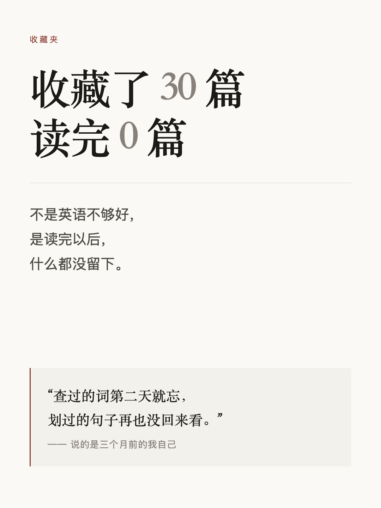
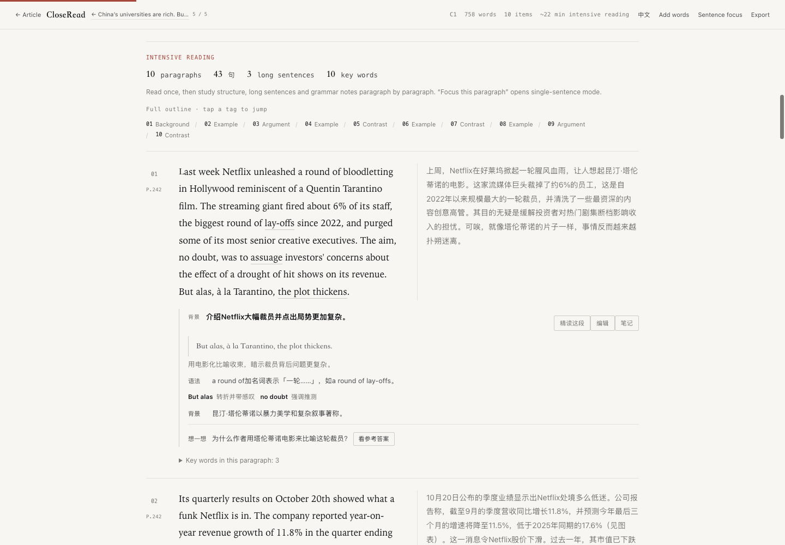
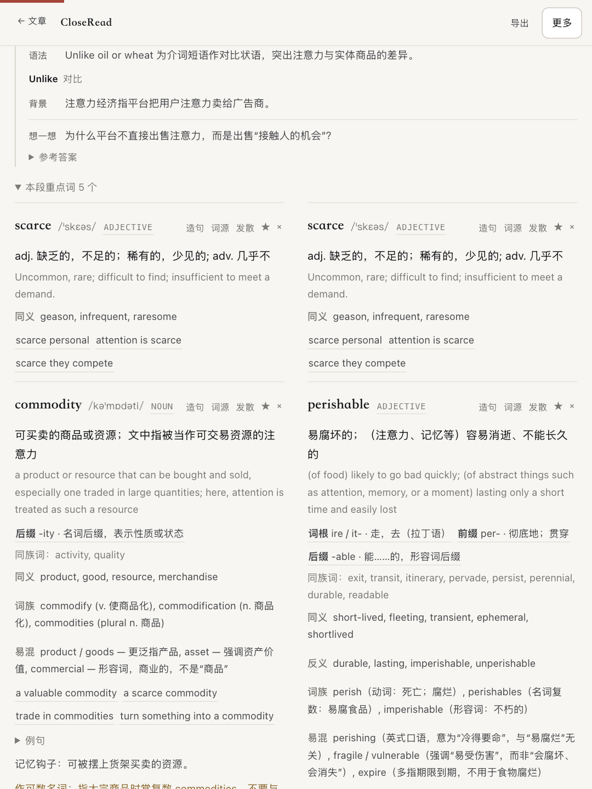
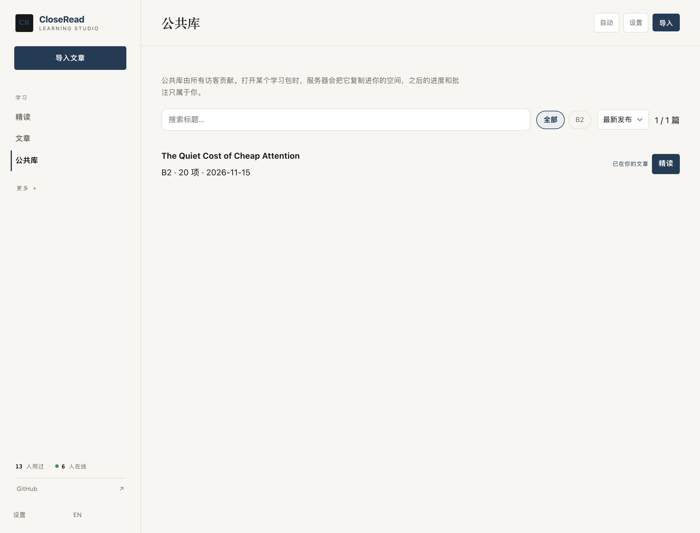

<!--
知乎文章草稿 · CloseRead
建议话题：英语学习 / 外刊精读 / 英语阅读 / 开源项目
配图已按文中顺序选好，发布时按顺序上传即可。
-->

# 我停掉了“每天 50 个单词”，改成一周只精读一篇

上个月整理收藏夹，我发现里面躺着一百多篇外刊。最长的一篇，我打开过六次，每次都停在第三段。

不是看不懂。是每次读之前，我都要先做一堆准备工作：查词、复制到笔记、找翻译、划重点、把生词丢进 Anki。做完这些，阅读的力气已经用完了。第二天再打开，上下文忘了，又从第一段开始。

后来我承认了一件事：我的问题不是词汇量，是我从来没有真正读完过一篇文章。

*图 1：收藏不等于读过。*

## 问题不在“读不懂”，在“读不完”

我们很容易把英语阅读当成一个词汇问题：读得慢，是因为词不够；读不懂，是因为语法不行。于是背单词、学语法、收藏更多“精读方法”。

但真实情况往往是，阅读被切成了太多碎片：

- 在阅读器里看原文；
- 在另一个窗口查词；
- 在笔记软件里记长难句；
- 在 Anki 里复习卡片；
- 在聊天框里让模型翻译。

每一件事都不难，难的是每次切换都要重新进入状态。一篇文章读下来，真正花在“读”上的时间可能不到一半。

所以我给自己换了一个目标：不追求每天学多少，只要求一周真正读完一篇。

## 我现在的精读流程

现在的规矩很简单：

1. 一周只选一篇，800–1200 词。
2. 第一遍不查词，只求知道它在讲什么。
3. 第二遍逐段读。每段先看英文，再看译文，最后看笔记。
4. 只收 5–8 个表达，不贪多。
5. 读完写三句话，不用长，能复述就行。
6. 周末花十分钟回看，不重新读全文。

这套流程的重点不是“学得多”，而是“读完”和“留下”。一篇文章只要真正读完，哪怕只记住三个表达，也比收藏十篇没读的要强。

*图 2：一页里完成原文、译文、段落笔记和重点词。*

## 一周一篇，会不会太少？

如果你说的“一篇”是这种精读，一周一篇不算少。

按 800–1200 词、每篇 2–3 小时计算，一年大约 50 篇、5 万词左右。这个量已经足够建立一个稳定的精读习惯。真正难的不是“一周少读了一篇”，而是连续八周都能读完。

但如果你一周只接触这一篇英文，那确实少。精读解决的是深度，泛读解决的是曝光量。只精读，语感和阅读速度上不来；只泛读，又容易停在“好像看懂了”的层面。

我现在用的是 1 + 3：

- **1 篇精读**：完整走完上面的流程，做笔记、收卡、写三句。
- **3 次泛读或听力**：每次 10–20 分钟，不查词，只抓大意。
- **1 次轻输出**：把本周收的表达用进三句话，或者复述一遍文章。

如果你刚开始，先不要加到三篇。连续四周都能完成 1 + 3，再考虑把精读加到两篇；第二篇可以只做“半精读”——读完、标三段、收三个表达，不跑完整流程。

## 为什么最后自己做了一个工具

这套流程用纸和笔也能做。但我试过几种工具，都不太顺手。

ChatGPT 能解释，但每段都要重新贴上下文，读完只剩一长串聊天记录。PDF 阅读器能划线，但译文、笔记、词卡各在一处。Anki 适合复习，可卡片离开原文之后，我经常想不起它为什么重要。

所以我写了一个工具，叫 **CloseRead**。它没有想替代所有工具，只解决一件事：让一篇文章从导入到读完，发生在同一个页面里。

现在它大概是这样：

- 支持 PDF、EPUB、MOBI、DOCX、网页链接、文本和转录；
- 一页里同时有原文、逐段译文、结构图、段落笔记、词卡、句子卡和练习；
- 选中 1–8 个词或一整句，直接加卡，卡片保留来源段落；
- 读完写三句英文，可以导出 Anki、Markdown、PDF、EPUB；
- 模型 Key 是可选的：不配置也能读公共库里已经生成好的文章。

*图 3：卡片不是从文章里抽出来的孤立词条，它保留原句和段落。*

*图 4：公共库里是已经生成好的学习包，打开就能读。*

## 它不适合谁

先说清楚，免得浪费时间。

如果你想要一键总结全文、每天背一百个词、扫描版 PDF 的 OCR，或者完全不想配置模型，它可能不适合你。它也不会绕过付费墙和 DRM。

它更适合这样的人：

- 收藏夹里有很多长文，但很少读完；
- 想读外刊、英文书，又不想把词卡从语境里撕下来；
- 愿意自己配置模型，换更细的译文和笔记；
- 希望内容能导出，不想被某个账号锁住。

## 这周只读一篇

现在线上有一个公开版本：

**https://closeread.weijia.asia**

不用注册。没有模型 Key 也能直接读公共库；要导入自己的文章，才需要配置 Key。工具本身开源免费，模型调用用你自己的 Key，费用由服务商收取。代码在：

**https://github.com/qweijiaq/CloseRead**

有一个限制需要提前说明：你导入的私有文章存在自己的浏览器里，服务器不保存；主动公开到公共库的那份副本除外。换设备要用「设备迁移」导出再导入；iPhone 长期不打开，浏览器可能清理站点数据。它不是网盘，也不是云账号。

这周我准备再读一篇。如果你也在囤文章，不妨只选一篇，读完它。

读完之后，欢迎来告诉我：你卡在哪一步？是选文章、查词，还是读到一半就走神。真实的使用场景，比“这个功能好不好”更有用。
